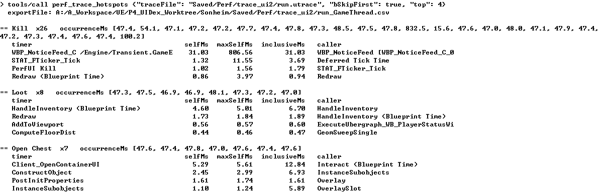
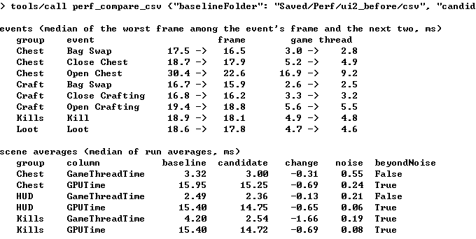

# Sonheim UI 성능 — 에이전트 조사 기록

[English](SonheimUiPerf.md)

이 문서는 **에이전트가 `perf-investigation` 스킬과 perf 도구로, 아무도 측정하지 않았던 UI에서 성능 문제를 찾고 고친 실제 작업**을 기록합니다. 대상은 Unreal Engine 5.5 리슨 서버 게임 [Sonheim](https://github.com/chungheonLee0325/Sonheim)입니다.

인벤토리·도감·지도의 끊김은 이전 작업에서 이미 고쳐진 상태였습니다. 이번에는 정답을 아는 사람이 없는 영역(퀘스트, 제작, 보관함, 전리품, 데미지 숫자)을 맡겼습니다. 아래 도구 결과는 2026-10-17 실제 작업 세션에서 발췌했습니다. 해당 수정은 [Sonheim PR #6](https://github.com/chungheonLee0325/Sonheim/pull/6)을 통해 `main`에 반영됐습니다.

```text
요청 → 장면 설계 → run.py 기준 측정 → perf_summarize_csv
     → run.py --trace → perf_trace_hotspots → 원인 코드 → 수정
     → run.py 재측정 → perf_compare_csv → 도구 개선 요청
```

## 요청

요청은 일부러 목표만 정했습니다.

> 인벤토리·도감·지도 밖의 UI 성능을 점검하고 개선할 가치가 있는 것을 찾아라. 후보: 퀘스트 일지와 대화, 제작, 보관함, 던전 UI, 알림 폭주, 전투 HUD. 플레이어가 느끼는 순간을 장면으로 만들고, 판단은 프레임 예산과 실행 간 편차에 비추어 하라. 확실히 가치 있는 것만 고치고 같은 장면으로 다시 측정하라.

어떤 위젯이 느린지, 어디를 고쳐야 하는지는 알려 주지 않았습니다.

## 1. 장면 설계

에이전트는 스킬을 읽고 UI 코드를 훑은 뒤, 프로젝트의 장면 실행기(`UPerfScenarioSubsystem`)에 장면 6개를 추가했습니다. 데이터는 후반 규모로 채웠고, 각 순간을 `CSV_EVENT`와 `PerfUI <순간>` 트레이스 범위로 표시했습니다.

| 장면 | 측정한 순간 |
|---|---|
| Loot | 쌓여 있는 아이템 5개를 한꺼번에 줍기 |
| Kills | 퀘스트 5개를 모두 받은 채 0.5초마다 처치 보고 |
| Journal | 퀘스트 일지에서 0.3초마다 다른 퀘스트 선택 |
| Hits | 데미지 숫자 20개를 한꺼번에 띄우기 |
| Craft | 가방을 채운 채 제작대(레시피 11개)를 열고 닫은 뒤 가방 정리 |
| Chest | 20칸을 채운 보관함을 열고 닫은 뒤 가방 정리 |

던전 UI는 던전 진행 상태를 만들어야 해서 이번 범위에서 뺐습니다.

## 2. 기준 측정 — `run.py`, `perf_summarize_csv`

에디터를 닫고 `run.py`로 3회 측정했습니다. 다른 프로세스의 CPU 부하는 실행마다 평균 4.8%, 5.8%, 7.6%로 기준(10%) 안이었습니다.

```text
python run.py --uproject <Sonheim.uproject> --label ui2_before --map /Game/_Maps/GameMap --runs 3
    --game-args "-PerfScenes=HUD,Loot,Kills,Journal,Hits,Craft,Chest -PerfSeconds=10 -PerfWarmup=3 -PerfLabel={label} -PerfRun={run}"
```

`perf_summarize_csv`의 결과에서 순간별 비용을 정리하면 다음과 같습니다(중앙값 / 최대, ms).

| 장면 | 순간 | Frame | Game Thread |
|---|---|---:|---:|
| HUD (기준) | — | 16.47 (장면 평균) | 2.49 (장면 평균) |
| Chest | Open Chest | 30.4 / 32.0 | 16.9 / 19.1 |
| Craft | Open Crafting | 19.4 / 20.3 | 5.6 / 6.3 |
| Loot | Loot | 18.6 / 20.7 | 4.7 / 5.5 |
| Journal | Pick Quest | 17.5 / 19.0 | 3.9 / 5.5 |
| Hits | Hits | 16.8 / 17.8 | 3.8 / 4.7 |
| Kills | Kill | 18.9 / **864.2** | 4.9 / **866.1** |

에이전트는 두 가지를 짚었습니다. 보관함 열기는 매번 두 프레임 가까이 걸리고, 처치 보고는 평소엔 가볍지만 한 번은 860ms 넘게 멈춥니다.

## 3. 원인 추적 — `run.py --trace`, `perf_trace_hotspots`

개선 효과는 앞 절의 **CSV 반복 측정**으로 판단하고, **CPU Trace는 비용이 집중된 타이머와 호출 경로**를 찾는 데 사용했습니다. Trace는 `-statnamedevents` 등의 계측 옵션을 사용하므로 아래 `occurrenceMs`와 CSV 이벤트 중앙값을 같은 수치로 비교하지 않았습니다.

트레이스를 한 번 기록하고 `perf_trace_hotspots`를 `bSkipFirst: true`로 호출했습니다. 결과 발췌입니다(순간 1회당 ms, `caller`는 그 시간을 가장 많이 부른 타이머).

```text
== Open Chest  (7회, occurrenceMs 47.0~47.8)
   Client_OpenContainerUI      self 5.29  max 5.61  incl 12.84  <- Blueprint Time
   ConstructObject             self 2.45  max 2.99  incl  6.93  <- InstanceSubobjects
   PostInitProperties          self 1.61  max 1.74  incl  1.61  <- Overlay
   InstanceSubobjects          self 1.10  max 1.24  incl  5.89  <- OverlaySlot

== Kill  (26회, occurrenceMs … 47.8, 832.5, 15.6 …)
   WBP_NoticeFeed_C …          self 31.03 max 806.56 incl 31.03
   PerfUI Kill                 self 1.02  max 1.56  incl  1.79

== Loot  (8회)
   Blueprint Time              self 4.76  max 5.16  incl  8.91  <- HandleInventory
   Redraw                      self 1.73  max 1.84  incl  1.89  <- Blueprint Time
   AddToViewport               self 0.56  max 0.57  incl  0.60  <- ExecuteUbergraph_WB_PlayerStatusWidget
```

같은 트레이스를 현재 도구 버전으로 다시 호출한 화면입니다. 이 버전은 동적 델리게이트 핸들러를 `HandleInventory (Blueprint Time)`처럼 자기 행으로 보여 줍니다(6절).



- **Open Chest:** 비용이 `Client_OpenContainerUI` 아래의 위젯 생성(`ConstructObject`, `InstanceSubobjects`)에 모여 있습니다. 보관함을 열 때마다 화면과 슬롯 위젯을 새로 만듭니다.
- **Kill:** 평균으로는 보이지 않던 멈춤이 `occurrenceMs`(832.5ms 한 회)와 `maxSelfMs`(알림 피드 806.56ms)에서 드러났습니다. 에이전트는 같은 시각의 게임 로그에서 `Ensure condition failed: CurrentNum == InitialNum`을 찾아, 알림 피드가 엔트리 목록을 순회하면서 같은 목록에서 행을 지우는 코드(`NoticeWidget.cpp`)로 연결했습니다.
- **Loot:** 아이템 하나마다 `UQuestComponent::HandleInventory`가 퀘스트 추적기를 다시 그리고 아이템 팝업을 하나씩 만듭니다.

트레이스 밖에서 찾은 문제도 하나 있습니다. 장면 실행기가 남기는 `OnInventoryChanged` 바인딩 수 로그가 보관함을 Tab으로 닫을 때마다 3 → 4 → 5 → 6으로 늘었습니다. 에이전트는 `Client_CloseContainerUI`가 이미 닫힌 위젯을 찾지 못해 `RemoveDynamic`이 실행되지 않는 경로를 코드에서 확인했습니다.

## 4. 판단과 수정

| 발견 | 판단 | 수정 |
|---|---|---|
| 보관함 열기 (GT 16.9ms) | 매번 한 프레임 이상 → 고침 | 보관함 화면에 `bKeepWhenClosed`를 켜고, 슬롯 그리드는 크기가 바뀔 때만 다시 만듦 ([코드](https://github.com/chungheonLee0325/Sonheim/blob/main/Sonheim/Source/Sonheim/UI/Widget/GameObject/ContainerWidget.cpp), [커밋](https://github.com/chungheonLee0325/Sonheim/commit/0b5916fd41a7d0e6a3904bd1cddea30fed189e40)) |
| 보관함 바인딩 누수 | 열고 닫을수록 쌓임 → 고침 | 가방 바인딩을 보관함 위젯이 열 때 묶고 `NativeDestruct`에서 풀도록 옮김 ([코드](https://github.com/chungheonLee0325/Sonheim/blob/main/Sonheim/Source/Sonheim/UI/Widget/GameObject/ContainerInteractionWidget.cpp), [커밋](https://github.com/chungheonLee0325/Sonheim/commit/0b5916fd41a7d0e6a3904bd1cddea30fed189e40)) |
| 알림 피드 ensure (806ms) | 개발 빌드에서 ensure 발생, 순회 중 엔트리 목록 변경 → 수정 | 엔트리 목록의 사본을 순회하며 제거 ([코드](https://github.com/chungheonLee0325/Sonheim/blob/main/Sonheim/Source/Sonheim/UI/Notice/NoticeWidget.cpp), [커밋](https://github.com/chungheonLee0325/Sonheim/commit/4c91e138d5801e7ea26b7dd3e07ccdffd6b1afb4)) |
| 전리품 줍기 (+2.2ms) | 줍는 순간 한 프레임 → 그대로 둠 | — |
| 제작대 열기 (+3ms), 퀘스트 선택 (+1.1ms), 데미지 숫자 (+0.6ms) | 예산 안 → 그대로 둠 | — |

## 5. 재측정 — `perf_compare_csv`

같은 장면을 `ui2_after`로 3회 측정하고 `perf_compare_csv`로 비교했습니다. 결과 발췌입니다.

```text
E Chest   Open Chest      frame  30.4 ->  22.6   GT  16.9 ->   9.2
E Chest   Close Chest     frame  18.7 ->  17.9   GT   5.2 ->   4.9
  Kills   GameThreadTime  4.20 -> 2.54   change -1.66  noise 0.19  bBeyondNoise
  HUD     GPUTime        15.40 -> 14.75  change -0.65  noise 0.06  bBeyondNoise
```



에이전트는 마지막 줄을 결과에서 뺐습니다. 코드를 건드리지 않은 HUD 장면까지 모든 장면의 GPU 시간이 약 0.7ms 함께 내려갔기 때문에, 장면 평균 프레임의 차이는 수정 효과가 아니라고 보고 게임 스레드와 순간 비용으로만 판단했습니다. 바인딩 수는 수정 후 열고 닫기를 반복해도 2로 유지됐고, ensure는 0회가 됐습니다.

추가로 보관함 화면을 남겨 두는 메모리 비용(위젯 객체 +0.94MB, 렌더 타깃·동적 머티리얼 변화 없음)과 리슨 서버 클라이언트 경로(바인딩 수 1 유지, 열기 게임 스레드 9.0~10.8ms로 호스트와 같음)를 확인했습니다.

## 6. 도구로 돌아간 것

에이전트는 보고 끝에 도구와 스킬에서 불편했던 점을 적었고, 그대로 Agent MCP에 반영했습니다.

| 보고 | 반영 |
|---|---|
| 동적 델리게이트 핸들러가 `Blueprint Time ← HandleInventory`처럼 섞여 보여 소스를 grep해야 했음 | `perf_trace_hotspots`가 핸들러마다 `<함수> (Blueprint Time)` 행을 따로 보여 줌 |
| ensure의 콜스택 기록이 이벤트 최대값을 지배하는데 표시가 없음 | `run.py`가 실행별 ensure 수를 `runs.json`에 남기고 `perf_summarize_csv`가 경고 |
| 서버를 거치는 순간(클라이언트의 보관함 열기)은 응답 도착이 20~35프레임 늦어 이벤트 창에 안 잡힘 | 스킬에 "클라이언트 RPC 핸들러에서 표시하라" 규칙 추가 |
| `perf_compare_csv`의 인자 이름이 스킬에 없음 | 스킬에 `baselineFolder`/`candidateFolder` 명시 |

반영 커밋: [Name delegate handlers in hotspots and warn about ensures](https://github.com/chungheonLee0325/AgentMcp/commit/18ffb76).

## 기록에 대해

- 이 세션의 에이전트는 MCP 클라이언트 연결 대신 짧은 HTTP 클라이언트 스크립트로 같은 MCP 엔드포인트(`tools/call`)를 호출했습니다. 결과는 에디터의 perf 도구가 반환한 그대로입니다.
- 숫자는 RTX 2070 SUPER, 1920×1080, 개발 빌드의 측정값이며 다른 환경의 성능값으로 일반화하지 않습니다.
