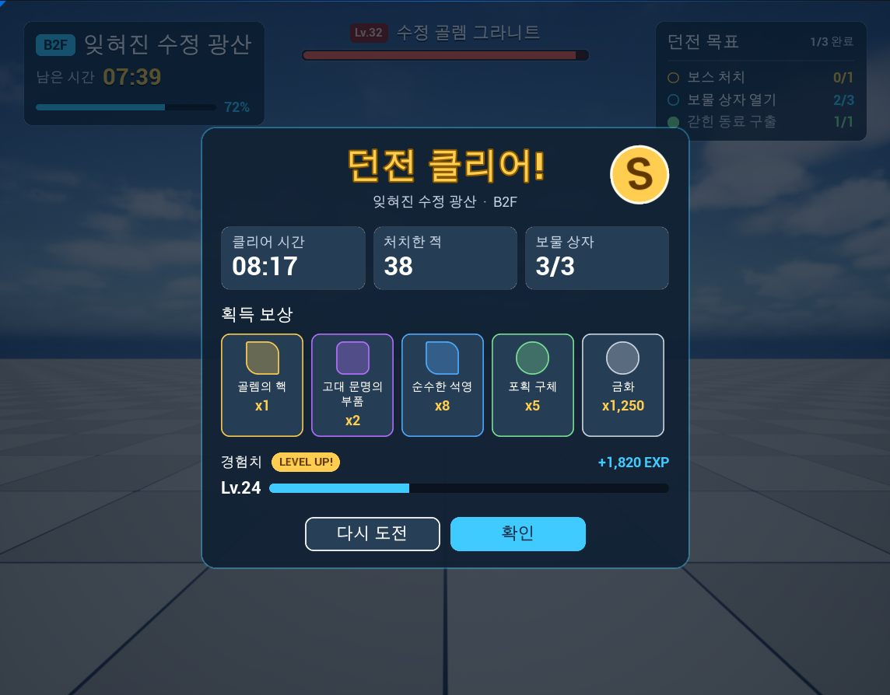
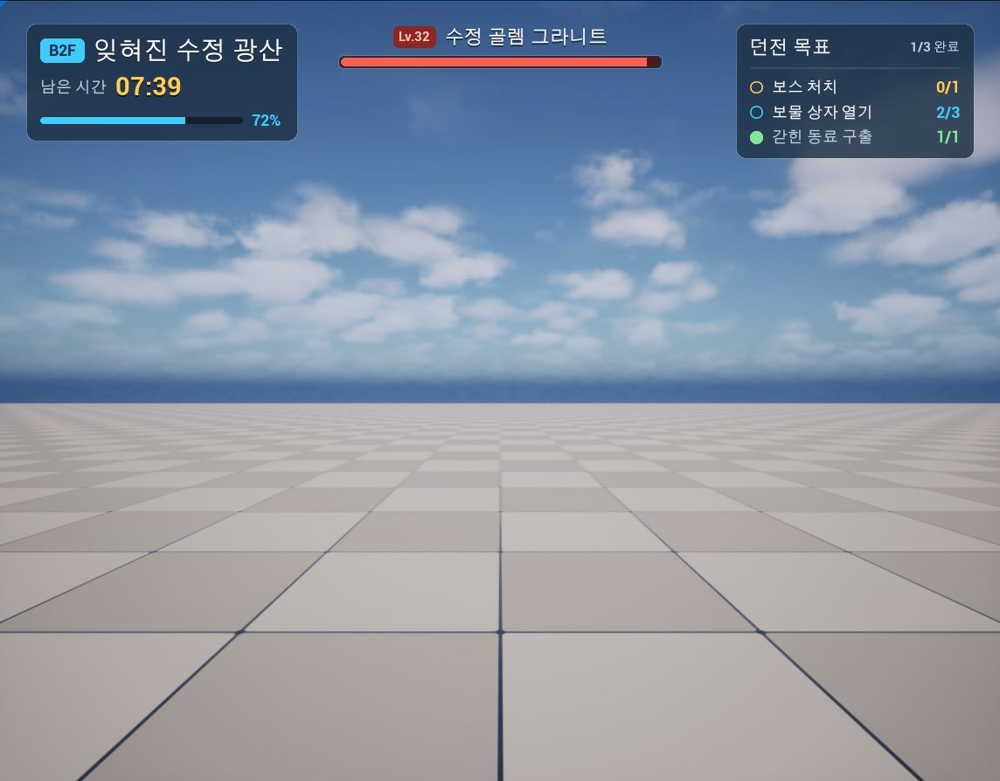

# Unreal Engine 5.5용 Agent MCP

[English](README.md)

Agent MCP는 Unreal Engine 5.5 에디터 안에서 [Model Context Protocol](https://modelcontextprotocol.io) 서버를 실행하여 Claude Code, Codex 같은 코딩 에이전트가 프로젝트를 **조사하고, 수정하고, 실행한 뒤 결과를 검증**할 수 있게 하는 에디터 플러그인입니다.

단순한 Unreal 원격 제어보다 **에이전트가 실제 게임 개발 작업을 수행하는 워크플로**에 초점을 맞췄습니다. Unreal Engine 5.8의 실험적 MCP/toolset 및 Agent Skill 개념을 참고하되, UE 5.5에서 동작하도록 새로 구현했고 Skill은 Claude Code·Codex와 호환되는 Markdown `SKILL.md` 형식으로 제공합니다.

## 핵심 특징

### Agent Skills

플러그인 자체가 작업 지침을 에이전트에게 제공합니다. Skill은 `SKILL.md`와 참고 파일·스크립트로 구성되며, 플러그인 기본 Skill 위에 프로젝트별 Skill을 덮어쓸 수 있습니다.

현재 포함된 Skill:

- `umg-authoring`: 재사용 가능한 Widget Blueprint 컴포넌트, C++ `BindWidget` 계약, 데이터 기반 목록, Theme Data Asset, 캡처 검토를 포함한 UMG 제작 규칙
- `ui-style-system`: 디자인 토큰, UI kit/gallery, 스타일 추출과 viewport capture 비교
- `ui-art-requests`: 이미지 모델·다른 에이전트·아티스트와 UMG 사이의 아트 요청 → 검수 → import → 연결 워크플로
- `blueprint-graphs`: 블루프린트 클래스와 로직. 클래스를 만들고 변수·함수·이벤트 디스패처를 추가하고, 노드 타입을 찾아 노드를 추가·연결한 뒤, 한 번 컴파일하고 플레이 세션에서 동작 확인
- `perf-investigation`: 증거로 끝나는 성능 작업. 독립 실행 게임에서 고정 장면 측정, 끊김 순간 표시, Insights 핫스폿, 실행 간 편차를 넘는지 따지는 전후 비교

### UMG 특화 도구

Widget Blueprint를 단순히 생성하는 데서 끝나지 않습니다.

- Widget Tree와 Named Slot 구조 분석
- C++ 부모 클래스의 `BindWidget` / `BindWidgetOptional` 계약과 실제 위젯 타입 검증
- Widget Blueprint 생성, 하위 트리 단위 추가, Widget/Slot 프로퍼티 변경
- 삭제 전 dry run과 바인딩·그래프 참조 영향 경고
- Blueprint compile → PIE → viewport capture → 수정의 반복 검증 루프

### 블루프린트 로직 도구

에이전트가 그래프 에디터를 열지 않고 블루프린트 로직을 만들 수 있습니다. 노드 타입 이름은 UE 5.8의 실험적 Blueprint toolset(`Development|PrintString`)을 따르고, UE 5.5 에디터 API로 새로 구현했습니다.

- 블루프린트 클래스 생성, 변수·입출력이 있는 함수·이벤트 디스패처 추가
- 에디터 노드 메뉴와 같은 노드 타입 검색. 특정 핀에 연결되는 타입만 고를 수도 있음
- 노드 추가·연결·삭제와 핀 값 설정을 한 호출로 수행. 먼저 전부 검사하고, undo 한 단계로 기록하며, 중간 실패 시 롤백
- 큰 그래프를 이벤트 체인 단위로 읽기. 노드별 컴파일 메시지 포함
- Blueprint compile → PIE → 로그로 검증

### Build → Run → Review

에이전트가 변경한 결과를 실행 화면으로 검증할 수 있도록 Blueprint/C++ 컴파일, Play In Editor, 로그 조회, viewport capture를 같은 MCP 서버에서 제공합니다.

```text
Inspect → Edit → Compile → PIE → Capture / Log → Review → Iterate
```

### 성능 조사

프로파일링 도구는 게임을 측정한 실행이 남긴 파일을 읽고, `perf-investigation` 스킬이 그 실행을 돌립니다.

- CSV 프로파일러 캡처를 장면별로 요약: 실행 평균의 중앙값, 실행 간 편차, 95번째 백분위, 화면 열기·드래그 앤 드롭처럼 표시한 순간(`CSV_EVENT`)의 비용
- 두 실행 묶음을 비교하고 양쪽 편차보다 큰 변화만 표시
- Insights를 열지 않고 Unreal Insights 트레이스를 내보내 표시한 순간의 프레임마다 타이머별 자체·포함 시간을 합산
- 게임 로그의 `ProfileGPU` 덤프를 패스 트리로 읽기
- 측정 전 머신 점검, 워밍업 실행, 백그라운드 부하 샘플링과 방해받은 실행의 재실행, 실행마다 사용자 설정 파일 복원

```text
장면 → 기준 측정 → 순간 표시 → 트레이스 → 원인 → 수정 → 후보 측정 → 비교
```

Sonheim 프로젝트에서 이 도구로 찾고 확인한 UI 수정 (1920×1080, 이벤트 중앙값):

| 순간 | 수정 전 | 수정 후 | 트레이스가 가리킨 원인 |
|---|---|---|---|
| 인벤토리 아이템 두 개 교환 | 프레임 32.6ms (게임 스레드 19.4ms) | 16.5ms (2.9ms) | 변경마다 모든 칸을 비웠다 다시 채우고 툴팁을 다시 붙임 |
| 인벤토리 열기 | 57.5ms (44.6ms) | 21.7ms (8.1ms) | 열 때마다 화면, 42칸, 아이템마다 툴팁을 새로 생성 |

### Reflection 기반 Toolset

도구는 일반 `static UFUNCTION`입니다. 이름, 설명, 인자와 반환 JSON 스키마를 Unreal Reflection에서 생성하므로 Toolset에 함수를 추가하면 MCP 도구가 됩니다.

### 에디터 안의 AI 채팅

기획자와 아티스트가 자기 Claude, ChatGPT, Google 계정으로 로그인해 프로젝트에 대해 묻고 변경을 맡길 수 있는 채팅 패널입니다. 권한 모드로 모델이 바꿀 수 있는 범위를 정하고, 모든 변경은 승인 카드를 기다립니다. [AI 채팅](Docs/AiChat.ko.md)을 보세요.

> **상태: 베타.** Windows 64비트의 Unreal Engine 5.5.4(설치형 빌드)로 빌드하고 테스트했습니다. 이 저장소의 smoke 테스트는 테스트베드 프로젝트에서 290개 검사를 통과합니다. Unreal Engine 5.7.4에서도 빌드되고 한 프로젝트에서 쓰고 있지만, 그곳에서 smoke 테스트는 아직 돌리지 않았습니다. 다른 플랫폼은 확인하지 않았습니다.

## Dungeon UI — 워크플로 검증 사례

`Content/Samples/DungeonUi`에는 Claude Code가 **UMG Designer를 열지 않고 Agent MCP Tool과 Skill로 제작한** 던전 진행 HUD와 결과 팝업이 있습니다.

첫 버전은 화면마다 48개/78개의 위젯을 한 번에 만든 평평한 트리였습니다. 동작은 했지만 반복 요소가 복사되어 있었고, 스타일 값이 인라인으로 흩어져 있었으며, 보상 목록도 데이터에 따라 늘어날 수 없었습니다.

리뷰를 반영하면서 제작 규칙을 `umg-authoring` Skill로 분리하고 UI를 다음 구조로 다시 만들었습니다.

```text
Flat Widget Tree
      ↓ review
Reusable Widget Blueprint Components
+ C++ BindWidget Contracts
+ DynamicEntryBox
      ↓ review
Theme Data Asset
+ DataTable
+ Art Request Pipeline
+ Capture-based Review
```





상세한 제작 과정과 반려된 버전에서 무엇을 고쳤는지는 [Dungeon UI 사례 문서](Docs/Samples/DungeonUi.ko.md)에 기록했습니다.

화면의 겉모습은 작은 디자인 시스템으로 관리합니다. 테마 데이터 에셋에 색·반경 토큰과 이름 붙인 박스·텍스트·바·버튼 스타일이 있고, 스타일 위젯은 스타일 이름만 저장하며, 키트 갤러리가 모든 토큰과 부품을 보여 줍니다. 에이전트가 `ui-style-system` 스킬의 스크립트로 스타일을 추출·적용·확인하는 방법은 [UI 스타일 시스템](Docs/UiStyleSystem.ko.md)에 있습니다.

## 문서 바로가기

| 문서 | 내용 |
|---|---|
| [클라이언트 연결](Docs/Clients.ko.md) | Claude Code와 Codex 설정, 여러 에디터의 포트 |
| [도구](Docs/Tools.ko.md) | 모든 도구와 접근 수준, 대표 작업 흐름 |
| [AI 채팅](Docs/AiChat.ko.md) | 에디터 채팅 패널: 공급자, 로그인, 권한 모드, 승인, 대화 |
| [스킬](Docs/Skills.ko.md) | 서버가 제공하는 `SKILL.md` 가이드와 읽는 위치 |
| [안전장치](Docs/Safety.ko.md) | 서버가 거부하는 것과 태그가 붙은 클라이언트의 승인 게이트 |
| [설정](Docs/Settings.ko.md) | 서버와 도구의 프로젝트 설정 |
| [도구 만들기](Docs/WritingTools.ko.md) | C++로 Toolset 추가하기 |
| [테스트베드와 smoke 테스트](Docs/Testing.ko.md) | 테스트베드 프로젝트, `mcp_smoke.py`, `mcp_call.py` |
| [Dungeon UI 샘플](Docs/Samples/DungeonUi.ko.md), [UI 스타일 시스템](Docs/UiStyleSystem.ko.md) | 위 검증 사례의 자세한 내용 |

## 설치

1. `Plugins/AgentMcp` 폴더를 프로젝트의 `Plugins` 폴더에 복사합니다.
2. **Edit > Plugins**에서 plugin을 켜거나, `.uproject` 파일에 추가합니다.
   ```json
   "Plugins": [ { "Name": "AgentMcp", "Enabled": true } ]
   ```
3. 프로젝트의 에디터 타깃을 빌드하고(plugin은 소스 코드로 배포됩니다) 에디터를 엽니다.

에디터 로딩이 끝나면 출력 로그에 다음 줄이 나옵니다.

```
LogAgentMcpProtocol: Agent MCP server listening on http://127.0.0.1:18765/mcp (39 tools).
```

에디터는 이어서 그 주소로 프로젝트 폴더에 `.mcp.json`과 `.codex/config.toml`을 씁니다. Claude Code는 추가 설정 없이 에디터를 찾습니다.
Codex는 신뢰한 폴더에서만 프로젝트 파일을 읽으므로, 모든 폴더에서 쓰려면 프로젝트 설정의 **Write User Codex Config**를 켜거나
`editor_write_client_config`를 `bUserCodexConfig`와 함께 호출합니다. 사용자 `~/.codex/config.toml`의 항목이 이 에디터를 가리키게 되며, 처음 바꾸기 전에 파일 사본을 남깁니다.
`AuthToken`을 설정하면 프로젝트 파일은 쓰지 않습니다. 저장소에 커밋되는 경우가 많아 토큰이 함께 올라가기 때문이며, 헤더는 아래처럼 직접 넣습니다.

에디터는 시작할 때 프로젝트 폴더에 Claude Code용 `.mcp.json`과 Codex용 `.codex/config.toml`을 씁니다. 직접 작성하거나, 토큰을 쓰거나, 에디터 여러 개를 동시에 띄우려면 [클라이언트 연결](Docs/Clients.ko.md)을 보세요. 에이전트는 `editor_get_state`부터 시작하면 됩니다.

## 한계

- Windows 64비트의 Unreal Engine 5.5.4에서 테스트했고, Windows 64비트의 Unreal Engine 5.7.4에서 쓰고 있습니다.
- Claude Code 2.1.270에서는 주요 조회·UMG·컴파일·PIE·저장·Skill·DataTable·asset 도구를 실제 UI 샘플 제작에 사용했습니다.
- Codex는 AI 채팅 패널을 통해 써 봤습니다. `.codex/config.toml`을 통한 직접 연결은 아직 테스트하지 않았습니다.
- 응답은 일반 JSON입니다. 스트리밍(SSE, 진행 알림)은 없습니다.
- 요청은 에디터의 게임 스레드에서 처리됩니다. **Use Less CPU when in Background**가 켜진 채 에디터가 백그라운드에 있으면 호출이 느려질 수 있습니다.
- `livecoding_compile`은 컴파일이 끝날 때까지 에디터를 멈추고, Live Coding은 `UCLASS`, `USTRUCT`, `UPROPERTY`, `UFUNCTION` 선언 변경을 적용하지 못합니다.
- 메시는 파일에 든 머티리얼·텍스처와 함께 임포트되며, 머티리얼을 만드는 도구는 없습니다. Fab 콘텐츠는 사용자의 Epic 계정이 필요한 Fab 플러그인으로 들여옵니다.
- 레벨 도구는 레벨 생성·열기와 액터 배치까지입니다. World Partition의 데이터 레이어, 스트리밍 소스, 레벨 인스턴스는 다루지 않으며, 파티션 레벨은 액터를 각자의 패키지에 저장합니다.
- `level_save`의 소스 컨트롤 동작은 확인하지 않았습니다.
- 블루프린트 변수, 함수, 이벤트 디스패처는 추가만 할 수 있고 아직 삭제나 이름 변경은 없습니다. 로컬 변수, 함수 오버라이드, 인터페이스는 다루지 않고 그래프 자동 정렬도 없습니다. 현지화된 에디터에서는 변수와 이벤트 디스패처 노드 타입 ID의 카테고리도 현지화됩니다. 위젯 애니메이션과 디자이너 프로퍼티 바인딩은 조회만 할 수 있고, 위젯을 다른 부모로 옮기거나 다른 클래스로 바꾸는 기능은 아직 없습니다. UI 샘플은 대신 하위 트리를 다시 만들었습니다.
- `ToolSearch` 노출 모드와 저장 시 소스 컨트롤 처리는 아직 테스트하지 않았습니다.

## 배경

도구 구성과 리플렉션 기반 설계는 Epic Games가 Unreal Engine 5.8에 포함한 실험적 Model Context Protocol·toolset plugin에서 아이디어를 가져와 Unreal Engine 5.5용으로 새로 구현했습니다. Agent Skill 역시 UE 5.8의 개념을 참고했지만, 이 프로젝트는 `UAgentSkill`을 포팅하지 않고 Claude Code·Codex와 공유할 수 있는 Markdown `SKILL.md` 기반 시스템을 별도로 구현했습니다.

이 저장소에는 Epic plugin의 소스 파일이 들어 있지 않습니다. Unreal과 Unreal Engine은 Epic Games, Inc.의 상표 또는 등록 상표입니다.

## 라이선스

[MIT License](LICENSE).
