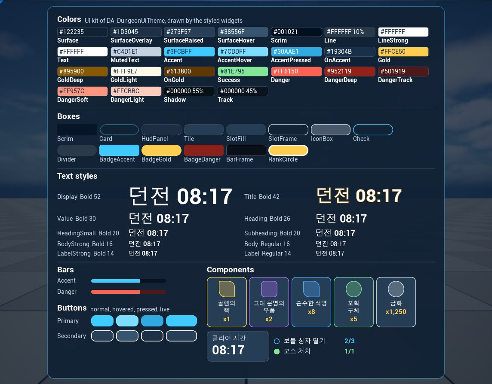

# Agent MCP

**Unreal Editor MCP + Agent Skills for Unreal Engine versions before 5.8**

[한국어](README.ko.md) · [Documentation](Docs/Index.md) · [Workflows](Docs/Workflows.md)

Agent MCP **reimplements editor-control capabilities inspired by Unreal Engine 5.8's experimental MCP Toolset for earlier engine versions**, and extends them with **dynamically loaded Agent Skills, UMG authoring and performance workflows, and AI chat inside the editor**.

**For:** Developers using pre-5.8 Unreal projects who want Claude Code, Codex or other agents to work in the editor, especially teams authoring UMG and investigating UI performance.  
**Used with:** Unreal Engine 5.5 / 5.7

## What makes it different?

- **MCP for pre-5.8 Unreal:** Editor tools based on the feature set of UE 5.8's experimental MCP Toolset, including actors, assets, Blueprints, UMG, compilation and PIE. This is an independent implementation, not a copy of Epic's plugin source.
- **Dynamically loaded Agent Skills:** The editor serves `SKILL.md` instructions to agents, reads their latest content on request, and lets projects override the defaults.
- **UI authoring and performance investigation:** Tools and Skills connect UMG creation, compilation, visual review, CSV profiling, Unreal Insights hotspot analysis and before/after comparisons.
- **AI chat inside Unreal Editor:** Use Claude Code, Codex or Gemini (through Antigravity) to inspect and edit projects conversationally, with permission modes and change approval cards.

## Built with Agent MCP

These testbed UIs were created by an agent using MCP tools and Skills, **without manually arranging the widgets in the UMG Designer**. The workflow iterated through Widget Blueprint authoring, compilation, PIE and captures.

| Dungeon result popup | UI style kit |
|:---:|:---:|
|  |  |

[View the dungeon HUD](Docs/Images/dungeon_hud.jpg) · [Dungeon UI case study](Docs/Samples/DungeonUi.md) · [UI style system](Docs/UiStyleSystem.md)

## Main capabilities

| Area | Capabilities |
|---|---|
| **Editor operations** | Inspect and edit actors, levels and assets; Data Assets, DataTables, string tables, imports and saves |
| **Blueprint / UMG** | Graph and usage inspection, node edits, Widget Trees and `BindWidget` contract checks, Widget Blueprint creation and edits |
| **Source and execution** | Source search/read/edit, Blueprint and Live Coding compilation, PIE, logs and viewport captures |
| **Agent Skills** | `skills_list` / `skills_get`, project overrides, loading task guidance and reference files |
| **Performance investigation** | Repeated CSV capture comparisons, `CSV_EVENT` moment analysis, Unreal Insights timers and `ProfileGPU` dumps |
| **AI chat** | Claude Code, Codex, Gemini (Antigravity) CLI, OpenAI/Gemini APIs and OpenAI-compatible endpoints, permissions and approvals |

[All tools and access levels](Docs/Tools.md) · [Task-oriented workflows](Docs/Workflows.md)

## UMG authoring workflow

Rather than just creating Widget Blueprints, the authoring workflow brings together **reusable components, data and style ownership, and review in the running game**.

```text
Inspect existing UI and classes
  → Plan reusable components and C++ BindWidget contracts
  → Create Widget Blueprints and Widget Trees
  → Connect DataTables, Theme Data Assets and images
  → Compile Blueprints
  → Run PIE, capture the screen and inspect logs
  → Iterate
```

The `umg-authoring`, `ui-style-system` and `ui-art-requests` Skills guide structure, style and asset handoff. The Dungeon UI sample evolved from duplicated subtrees into reusable components, with styles centralized in a Theme Data Asset.

[Read the UI case study](Docs/Samples/DungeonUi.md)

## UI performance workflow

The `perf-investigation` Skill guides **repeatable measurements in fixed standalone-game scenes**, then checks whether an improvement exceeds run-to-run variation. The `perf_summarize_csv`, `perf_compare_csv`, `perf_trace_hotspots` and `perf_read_gpu_profile` tools analyze the generated files. Automated runs require a project-specific performance scene runner.

```text
Repeat baseline scenes → Mark stalls with CSV_EVENT
  → Inspect Unreal Insights / GPU data → Fix the cause
  → Repeat identical conditions → Compare before and after
```

Sonheim inventory UI example (1920×1080, medians of marked events):

| Action | Before: frame (game thread) | After: frame (game thread) |
|---|---:|---:|
| Swap two inventory items | 32.6ms (19.4ms) | 16.5ms (2.9ms) |
| Open the inventory | 57.5ms (44.6ms) | 21.7ms (8.1ms) |

Investigation identified full slot and tooltip rebuilds, and widgets being recreated on every screen open. [Performance workflow](Docs/Workflows.md#6-measure-and-compare-performance)

## AI chat in the editor

Open **Window > Agent MCP > AI Chat** or use the editor toolbar to ask about the project and request changes.

- **Claude Code:** Sign in through the Claude CLI
- **Codex:** Sign in through the Codex CLI with a ChatGPT account
- **Gemini:** Connect a Google account through the Antigravity CLI
- **Other providers:** OpenAI/Gemini APIs and OpenAI-compatible servers

The panel offers **read-only / asset editing / code editing / asset + code editing** modes and approval cards for changes. These cards are **not automatically applied** to external clients connected directly over MCP.

[AI chat setup and permissions](Docs/AiChat.md)

## Agent Skills and extension model

Tools are `static UFUNCTION` methods backed by Unreal Reflection. Skills are separate Markdown `SKILL.md` guides. In other words, **tools expose operations**; **Skills describe how to use those operations in a production workflow**.

`skills_get` reads the Skill file on request, so edits take effect without restarting the editor. Projects can override built-in Skills from `AgentMcp/Skills` or directories in `SkillDirectories`. The Skill list in the initial MCP server instructions is generated on server startup.

Included Skills: `umg-authoring` · `ui-style-system` · `ui-art-requests` · `blueprint-graphs` · `perf-investigation`

[Skills](Docs/Skills.md) · [Writing C++ tools](Docs/WritingTools.md)

## Installation and connection

1. Copy this repository's `Plugins/AgentMcp` to `Plugins/AgentMcp` in your Unreal project.
2. Enable **Agent MCP** under **Edit > Plugins**, or add `{"Name": "AgentMcp", "Enabled": true}` to your existing `.uproject` `Plugins` array.
3. **Build your project's Editor target** and launch the editor.

The default MCP endpoint is `http://127.0.0.1:18765/mcp`. On startup the editor writes a `.mcp.json` for Claude Code and a `.codex/config.toml` for Codex into the project directory. See [Connecting clients](Docs/Clients.md) for tokens, multiple editors and manual configuration.

Start by calling `editor_get_state` to confirm the target project and current level.

## Documentation and boundaries

[Documentation index](Docs/Index.md) · [Tools](Docs/Tools.md) · [Workflows](Docs/Workflows.md) · [Settings](Docs/Settings.md) · [Safety](Docs/Safety.md) · [Testbed](Docs/Testing.md)

- Source edits (`source_replace` / `source_write`) cannot be reverted through Unreal Editor Undo; use source control.
- Live Coding cannot apply reflected declaration changes such as `UCLASS` or `UPROPERTY`.
- Some Blueprint and UMG operations, including Widget Animation authoring and automatic graph layout, are not supported.
- The design takes inspiration from UE 5.8's experimental MCP Toolset and Agent Skill concepts but is **independently implemented for earlier engine versions**. It does not copy Epic plugin source or port `UAgentSkill`.

[MIT License](LICENSE) · Unreal Engine is a trademark of Epic Games, Inc.
